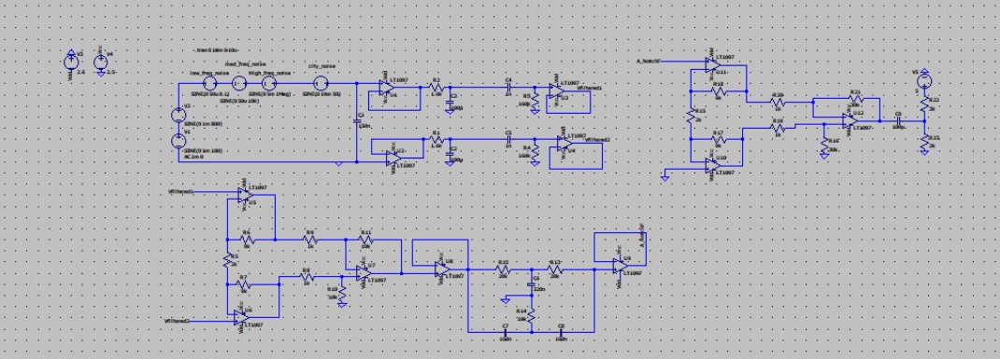
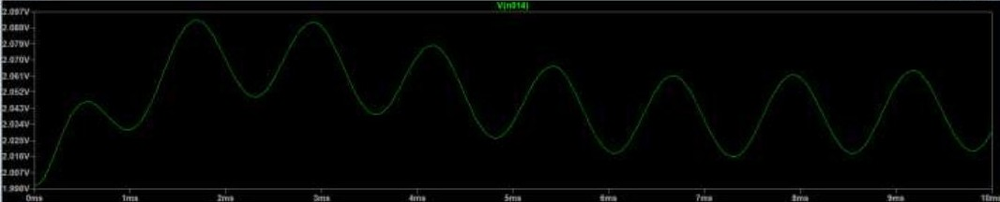
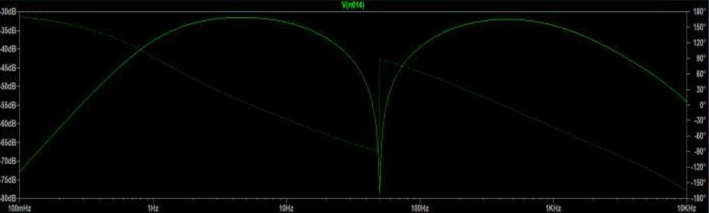
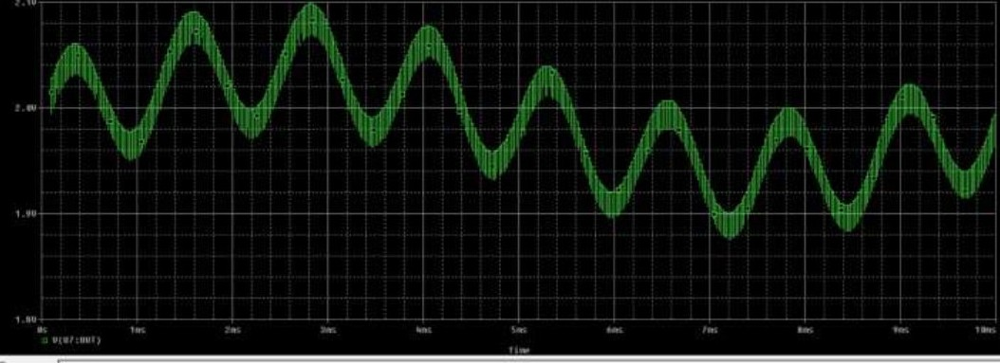

# Analog Signal Conditioning & Mixed-Signal Chain for Robotic Slip Detection

[](#getting-started)
[](#getting-started)
[](Project/slip_detection_report.pdf)
[-1f4e79.svg)](#authors)

Design, circuit-level simulation, and mixed-signal verification of a complete analog signal-conditioning and data-acquisition front-end for a piezoelectric tactile slip sensor. Translates low-amplitude raw transducer signals into a filtered, level-shifted, and digitized output for robotic grip control. Developed for the **Sensing and Measurement** course at **Sharif University of Technology**.

> [!IMPORTANT]
> **Design Objective:** Condition a raw $\pm 1\text{ mV}$ piezoelectric micro-vibration signal through multi-stage instrumentation amplification, active band-pass filtering, $50\text{ Hz}$ notch rejection, and DC level shifting into a clean $2\text{ V}$-centred dynamic range suitable for unipolar Analog-to-Digital Conversion (ADC).

<p align="center">
  
  
</p>

---

## System Stages & Technical Highlights

| Stage | Circuit / Simulation Module | Specifications & Key Artifacts |
| :--- | :--- | :--- |
| **1. Transducer Modelling** | Piezoelectric Equivalent Circuit | Models the raw piezoelectric slip sensor source (`PiezoElectricModel.jpg`, `PiezoElectricModelOutput.jpg`). |
| **2. Instrumentation Amplification** | Dual-Stage Instrumentation Amplifier | High-CMRR differential amplification of low-level sensor signals (`InstrumentaionCircuit.jpg`, `AfterSecondInstrumentationOutput.jpg`). |
| **3. Band-Pass & Notch Filtering** | Active Band-Pass ($1\text{ Hz}\text{–}1\text{ kHz}$) & $50\text{ Hz}$ Notch | Isolates tactile slip frequencies, removes DC drift, and rejects mains hum (`FilterOutput.jpg`, `NotchFilter.jpg`, `AmayeshCircuitOutputFrequency.jpg`). |
| **4. Level Shifting & Buffering** | Output Buffer & DC Offset Stage | Shifts the conditioned analog waveform to a **$2\text{ V}$-centred** ADC-compatible range (`BufferAndFilter.jpg`). |
| **5. Mixed-Signal ADC / DAC** | PSpice ADC & DAC Verification | Evaluates quantization, sampling-rate effects, and signal reconstruction (`ADCFigure.jpg`, `ADCOutputAfterSampleRateChange.jpg`, `DAOutput.jpg`). |
| **6. Frequency & System Verification** | LTspice AC/Transient & MATLAB | Cross-validates frequency response (`Frequency Response.asc`) and system-level behaviour (`Project/Simulations/Matlab.pdf`, `matlabfigure.png`). |

<p align="center">
  
  
</p>

---

## Scope & Limitations

- **Simulation Environment:** Verified through circuit-level transient and AC frequency-response simulations in **LTspice** (`.asc`) and **OrCAD PSpice** (`.DSN`), complemented by analytical verification in **MATLAB** (`Project/Simulations/Matlab.pdf`).
- **Hardware Scope:** Physical PCB layout and integration onto a physical robotic gripper were outside the scope of this course project.

---

## Getting Started

```bash
git clone https://github.com/mohamahdavi/Slip-Detection-Signal-Conditioning.git
cd Slip-Detection-Signal-Conditioning/Project

# LTspice simulations (Frequency Response & Transient):
# Open "Simulations/Spice Simulations/Preparation Output/Frequency response/Frequency Response.asc"
# Open "Simulations/Spice Simulations/Preparation Output/Transient/Transient.asc"

# OrCAD PSpice mixed-signal schematics (ADC & DAC):
# Open "Simulations/Spice Simulations/ADC/ADC.opj" and "Simulations/Spice Simulations/DAC/DAC.opj"
```

---

## Repository Structure

```text
.
├── README.md
└── Project/
    ├── slip_detection_report.pdf      # Compiled technical report
    ├── slip_detection_report.tex      # LaTeX source for the technical report
    ├── Figures/                       # Circuit schematics, transient/AC plots, ADC/DAC & MATLAB figures
    └── Simulations/
        ├── Matlab.pdf                 # MATLAB verification script & output documentation
        └── Spice Simulations/
            ├── ADC/                   # OrCAD PSpice ADC schematic & simulation files (.DSN, .opj)
            ├── DAC/                   # OrCAD PSpice DAC schematic & simulation files (.DSN, .opj)
            └── Preparation Output/    # LTspice AC frequency-response & transient schematics (.asc)
```

---

## Authors
- Mohammad Mahdi Barzegar
- Mohammad Reza Mahdavi
- Mohammad Moein Abolfathi
